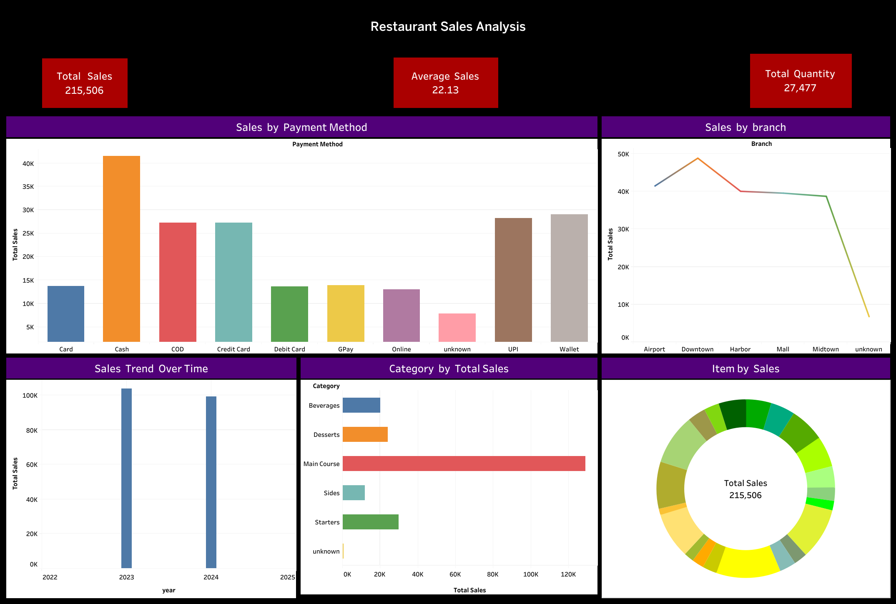

# 🍽️ Restaurant Sales Analysis

An end-to-end data analytics project that cleans a raw restaurant sales dataset using **Google Sheets** and visualizes the results in an interactive **Tableau** dashboard.

---

## 📌 Table of Contents

- [Project Overview](#-project-overview)
- [Objectives](#-objectives)
- [Tech Stack](#-tech-stack)
- [Project Workflow](#-project-workflow)
- [Repository Structure](#-repository-structure)
- [Data Cleaning (Google Sheets)](#-data-cleaning-google-sheets)
- [Tableau Dashboard](#-tableau-dashboard)
- [Key Insights](#-key-insights)
- [How to Reproduce](#-how-to-reproduce)
- [Future Improvements](#-future-improvements)
- [Author](#-author)

---

## 📖 Project Overview

Raw sales data is rarely analysis-ready. This project starts with an **unclean CSV dataset** of restaurant sales, which is imported into **Google Sheets** and cleaned using built-in functions and tools. The cleaned data is then exported to CSV and loaded into **Tableau**, where an interactive dashboard surfaces sales trends and business insights.

---

## 🎯 Objectives

- Import a messy, unclean CSV dataset into Google Sheets
- Clean and standardize the data (duplicates, missing values, inconsistent formats, incorrect data types, etc.)
- Export the cleaned dataset back to CSV
- Build an interactive Tableau dashboard to analyze restaurant sales performance

---

## 🛠️ Tech Stack

| Tool | Purpose |
|------|---------|
| **CSV** | Raw and cleaned data format |
| **Google Sheets** | Data import and cleaning |
| **Tableau** | Data visualization and dashboard creation |

---

## 🔄 Project Workflow

```
Unclean CSV Dataset
        │
        ▼
Import into Google Sheets
        │
        ▼
Data Cleaning in Sheets
        │
        ▼
Export Cleaned Data to CSV
        │
        ▼
Import into Tableau
        │
        ▼
Interactive Dashboard
```

---

## 🧹 Data Cleaning (Google Sheets)

The raw CSV was imported into Google Sheets and cleaned using built-in features and formulas.

### Typical cleaning steps performed

- ✅ Removed duplicate rows (`Data > Data cleanup > Remove duplicates`)
- ✅ Handled blank / missing values
- ✅ Trimmed extra spaces (`TRIM`) and standardized text casing (`PROPER`, `UPPER`, `LOWER`)
- ✅ Fixed inconsistent or misspelled entries (`Find and replace`)
- ✅ Converted columns to correct formats (dates, numbers, currency)
- ✅ Split or combined columns where needed (`SPLIT`, `CONCATENATE`)
- ✅ Removed invalid or corrupted records

> 📝 *Edit this list to reflect exactly what you did in your sheet.*

### Exporting the cleaned data

`File > Download > Comma-separated values (.csv)`

---

## 📊 Tableau Dashboard

The cleaned CSV was imported into Tableau, where worksheets were built and combined into an interactive dashboard.

### Dashboard Preview

<p align="center">
  
</p>

<!--
IMAGE NOT SHOWING? Check these:
1. The file really exists at dashboard/dashboard.png in your repo (commit AND push it).
2. The name matches exactly. GitHub is case-sensitive: dashboard.png is not Dashboard.PNG.
3. No spaces in the file name (use dashboard.png, not "my dashboard.png").
4. Alternative: drag and drop the image into the GitHub README editor and
   GitHub will generate a working link for you.
-->

### Dashboard Features

- 📈 Sales trends over time (daily / monthly)
- 🍕 Top-selling menu items and categories
- 💰 Revenue and profit breakdown
- 🕒 Peak hours and busiest days
- 🔍 Interactive filters and parameters
- 🔢 Key KPI cards (total sales, orders, average order value, etc.)

> 📝 *Adjust these to match the visuals in your dashboard.*

---

## 💡 Key Insights

- *Insight 1 – e.g., Best-selling menu item or category*
- *Insight 2 – e.g., Peak sales months, days, or hours*
- *Insight 3 – e.g., Highest-revenue location or order type (dine-in / takeaway / delivery)*
- *Insight 4 – e.g., Preferred payment method or average order value trend*

> 📝 *Replace these placeholders with the real findings from your dashboard.*

---

## ▶️ How to Reproduce

1. **Clone the repository**
   ```bash
   git clone https://github.com/<your-username>/<your-repo>.git
   cd <your-repo>
   ```
2. **Import the raw dataset** into Google Sheets (`File > Import`).
3. **Clean the data** by following the steps listed above.
4. **Download the cleaned sheet** as a CSV file.
5. **Open Tableau** → *Connect* → *Text file* → select the cleaned CSV.
6. **Open the Tableau workbook** to explore the dashboard, or rebuild the visuals yourself.

---

## 🚀 Future Improvements

- Automate cleaning with Google Apps Script or Python
- Connect Tableau directly to Google Sheets for live updates
- Add forecasting and predictive analysis
- Publish the dashboard to Tableau Public

---

## 👨‍💻 Author

**Subhajit Chatterjee**  
**Data Analyst** at Farmershop Tech India Pvt. Ltd.

- **Role:** Data Analyst
- **Company:** Farmershop Tech India Pvt. Ltd.
- **Skills:** Google Sheets, SQL, Power BI, Data Cleaning, Data Visualization, and Business Intelligence

This project demonstrates my ability to clean and analyze hotel booking data, develop meaningful KPIs, and build interactive Power BI dashboards to support data-driven business decisions.

---

⭐ *If you found this project useful, consider giving it a star!*
